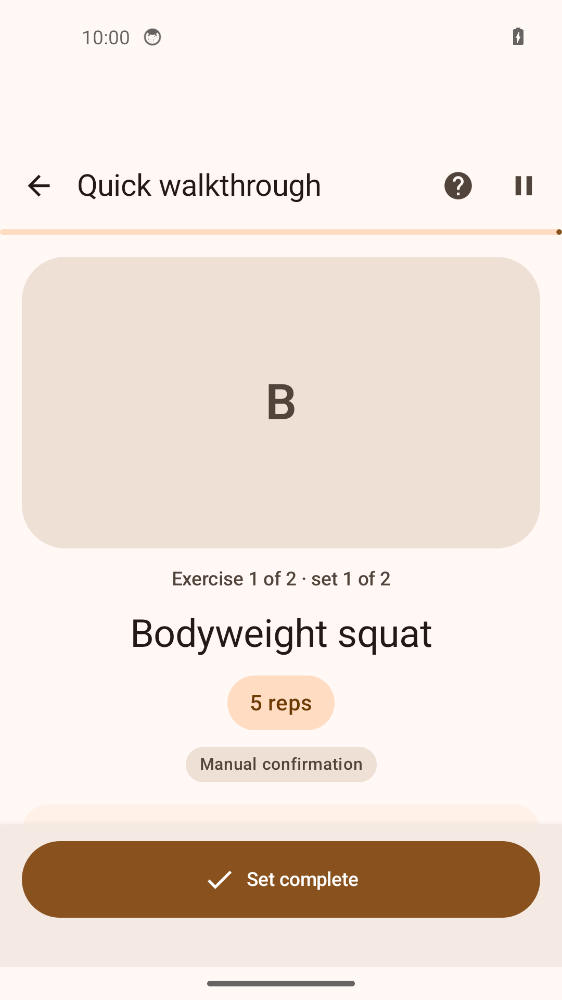
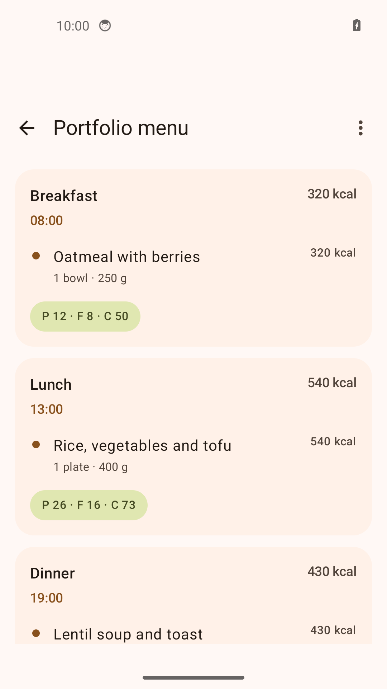
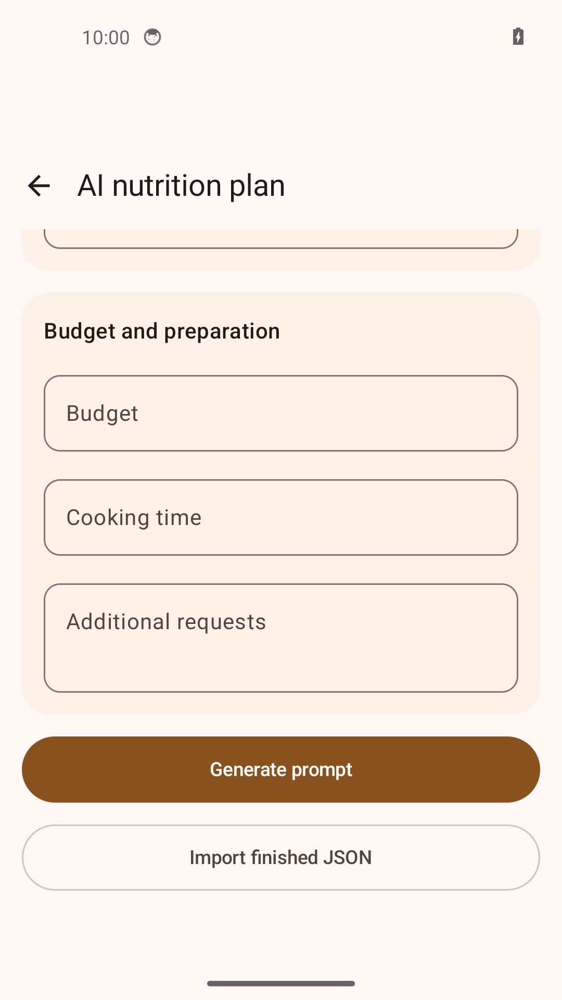

# FitRegimen

[English](README.md) · [Русский](README.ru.md) · [Deutsch](README.de.md) · [Español](README.es.md)

[](https://github.com/IgorNadein/FitRegimen/actions/workflows/android.yml)
[](https://github.com/IgorNadein/FitRegimen/releases)

**Eine Android-App zum Erstellen von Trainingsprogrammen, Durchführen angeleiteter Workouts und Planen von Mahlzeiten.** FitRegimen erweitert [FitoTrack](https://codeberg.org/jannis/FitoTrack), den quelloffenen Aktivitätstracker von **Jannis Scheibe und den Mitwirkenden des Projekts**. Entwicklung des Forks: [Igor Nadein](https://github.com/IgorNadein).

**[APK herunterladen](https://github.com/IgorNadein/FitRegimen/releases/latest) · [Installation](doc/INSTALL.md) · [Demo in 5 Minuten](doc/demo/README.md) · [Änderungen](CHANGELOG.md)**

## Erweiterungen dieses Forks

- **Programmeditor:** Trainingstage und Ruhetage, Übungskatalog, Sätze, Wiederholungen, Gewichte, Dauer, Vorbereitung und Pausen; Import und Export als JSON.
- **Angeleitete Workouts:** manuelle Satzbestätigung, Timer, Anbindung an die vorhandene Aufzeichnung, gespeicherter Sitzungszustand und Ergebnisse unabhängig vom bearbeitbaren Programm.
- **Ernährungsplanung:** Tage, Mahlzeiten und Lebensmittel, Mengen, Kalorien und Makronährstoffe; manuelle Bearbeitung, JSON-Austausch und Verknüpfung mit Profilen und Trainingsprogrammen.
- **Vorbereitung von KI-Anfragen und geprüfter Import generierter Pläne:** eine strukturierte Anfrage vorbereiten, an einen externen Assistenten eigener Wahl übergeben und dessen JSON-Antwort importieren. Kein eingebautes Modell, API-Schlüssel oder automatischer Zugriff auf KI-Dienste erforderlich.
- **Übertragbare Sicherungen:** Trainings- und Ernährungspläne, Übungen und Medien, Profile, Trainings- und Sitzungsverlauf sowie übertragbare Einstellungen; Wiederherstellung durch Ersetzen oder Zusammenführen.

Die technische Arbeit umfasst Kotlin/Jetpack Compose, Room-Datenmodelle und Migrationen, dauerhaft gespeicherte Trainingsabläufe, versionierte Austauschformate, Importprüfungen und Regressionstests. Siehe [Sitzungsarchitektur](doc/guided-workout-architecture.md) und [Testquellen](app/src/test/java/de/tadris/fitness).

## Aktuelle Ansichten

Aufnahmen der Android-App mit den [mitgelieferten Beispieldateien](doc/demo). Die erste Ansicht zeigt den Programmeditor.

| Programmeditor | Laufendes Workout |
| --- | --- |
|  |  |
| Ernährung | KI-Plan importieren |
|  |  |

## Ausprobieren

1. Die signierte **FitRegimen-0.2.0.apk** aus den [Releases](https://github.com/IgorNadein/FitRegimen/releases/latest) auf Android **8.0 oder neuer** installieren.
2. [program.json](https://raw.githubusercontent.com/IgorNadein/FitRegimen/master/doc/demo/program.json) herunterladen und unter **Programme → + → Programm importieren** auswählen.
3. **Quick walkthrough** öffnen, zwei Sätze bestätigen, den 20-Sekunden-Timer abschließen und das Ergebnis ansehen.
4. Eine Sicherung exportieren und wiederherstellen. Die [Demo-Anleitung](doc/demo/README.md) enthält genaue Schritte und erwartete Ergebnisse, auch für Ernährung und KI-Import.

Für die Demo werden weder Konto noch GPS-Aufzeichnung oder externer KI-Dienst benötigt. Die fiktiven Beispieldaten dienen der Bedienungsdemonstration und sind keine persönlichen Trainings- oder Ernährungsempfehlungen.

Ab Version 0.2.0 kannst du unter **Einstellungen → Updates** GitHub Releases prüfen, eine verifizierte APK herunterladen und das Android-Installationsprogramm öffnen. Version 0.1.0 muss einmal manuell aktualisiert werden. [Technische Details](doc/updates.md).

## Was „KI“ hier bedeutet

Die App erstellt aus den Eingaben und dem Planformat eine Anfrage. Sie entscheiden über die Aufnahme von Profildaten; beim Senden an einen externen Dienst erhält dieser die enthaltenen Daten. Die generierte Antwort wird als JSON gespeichert und in der App ausgewählt.

Der Programmimport prüft JSON, unterstützte Formatversionen, die erforderliche Struktur und Übungsverweise und unterstützt ältere Formate. Der Ernährungsimport begrenzt zusätzlich Dateigröße, Strukturumfang, Textlängen und Zahlenbereiche und weist private Sicherungsfelder zurück. Fehler werden angezeigt; importierte Pläne bleiben bearbeitbar. Dies sind **Datenprüfungen**, keine Garantie für die persönliche Eignung eines Plans. [Ablauf und Grenzen](doc/AI.md).

Planung, manuelle Workouts, Timer und lokaler Dateiaustausch funktionieren offline. Externe KI, Online-Karten, entfernte Übungsvideos und konfigurierte Uploads benötigen eine Verbindung. [Datenschutz](doc/privacy-policy.md).

## Build und Prüfungen

Voraussetzungen: **JDK 21**, Android SDK **37.0**, Build Tools **36.0.0** und der enthaltene Gradle-Wrapper:

```sh
sdkmanager 'platforms;android-37.0' 'build-tools;36.0.0'
./gradlew testDebugUnitTest assembleDebug assembleRelease
```

Die installierbare Debug-APK liegt unter `app/build/outputs/apk/debug/app-debug.apk`. Die Release-APK muss vom Maintainer signiert werden. [GitHub Actions](.github/workflows/android.yml) führt JVM-Tests und beide APK-Builds bei Pushes und Pull Requests aus und stellt APKs und Testberichte bereit. Gerätetests werden im CI nicht ausgeführt. [Weitere Build- und Installationshinweise](doc/INSTALL.md).

## Ursprungsprojekt und Lizenz

**GPS- und Indoor-Aufzeichnung, Routenkarten, Sensoranbindungen, GPX-Austausch und die ursprüngliche Statistikberechnung stammen aus FitoTrack.** Diese Arbeit wird dem Ursprungsprojekt zugeschrieben. Der Fork ergänzt Programme, Sitzungen und Ernährungsplanung.

FitRegimen steht weiterhin unter der **GPLv3 oder einer späteren Version**. Die ursprünglichen Urheberrechtshinweise bleiben erhalten: [LICENSE.txt](LICENSE.txt), [NOTICE.md](NOTICE.md), [FitoTrack-Quellcode](https://codeberg.org/jannis/FitoTrack) und [Unterstützung für FitoTrack](https://liberapay.com/jannis/donate). Fehler und Beiträge zu FitRegimen gehören in [dieses Repository](https://github.com/IgorNadein/FitRegimen/issues).
