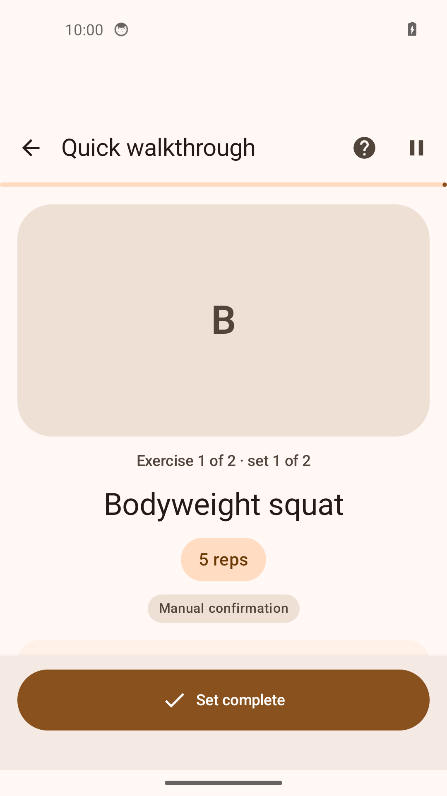
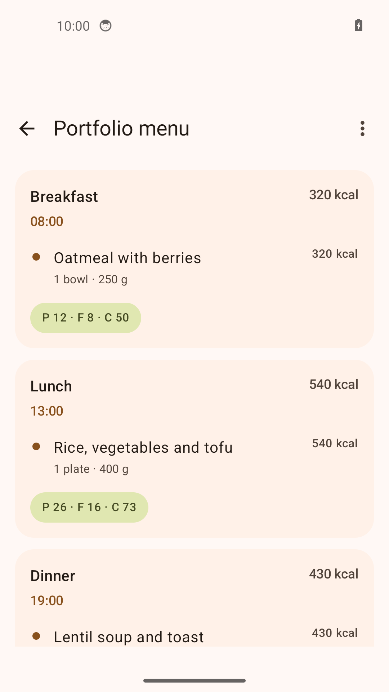
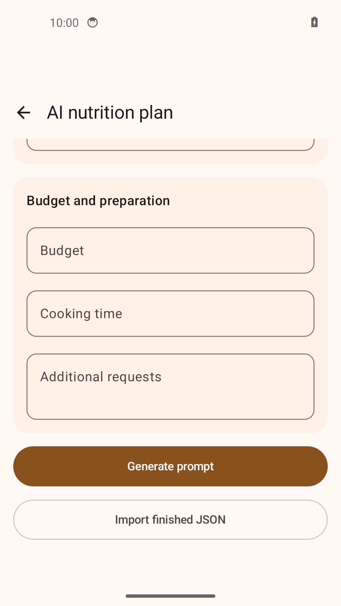

# FitRegimen

[English](README.md) · [Русский](README.ru.md) · [Deutsch](README.de.md) · [Español](README.es.md)

[](https://github.com/IgorNadein/FitRegimen/actions/workflows/android.yml)
[](https://github.com/IgorNadein/FitRegimen/releases)

**Una aplicación Android para crear programas, realizar entrenamientos guiados y planificar comidas.** FitRegimen amplía [FitoTrack](https://codeberg.org/jannis/FitoTrack), el registro de actividad de código abierto creado por **Jannis Scheibe y los colaboradores del proyecto**. Desarrollo de esta bifurcación: [Igor Nadein](https://github.com/IgorNadein).

**[Descargar APK](https://github.com/IgorNadein/FitRegimen/releases/latest) · [Instalación](doc/INSTALL.md) · [Demo de 5 minutos](doc/demo/README.md) · [Cambios](CHANGELOG.md)**

## Aportaciones de esta bifurcación

- **Editor de programas:** días de entrenamiento y descanso, catálogo de ejercicios, series, repeticiones, pesos, duración, preparación y descansos; importación y exportación JSON.
- **Entrenamientos guiados:** confirmación manual de series, temporizadores, integración con el registro existente, estado de sesión persistente y resultados independientes del programa editable.
- **Planificación de comidas:** días, comidas y alimentos, cantidades, calorías y macronutrientes; edición manual, intercambio JSON y vínculos con perfiles y programas de entrenamiento.
- **Preparación de solicitudes para IA e importación validada de planes generados:** preparar una solicitud estructurada, utilizar el asistente externo que prefieras e importar su respuesta JSON. No requiere un modelo integrado, clave API ni conexión automática con servicios de IA.
- **Copias de seguridad portátiles:** programas de entrenamiento y alimentación, ejercicios y archivos multimedia, perfiles, historial de entrenamientos y sesiones, y ajustes portátiles; restauración con sustitución o combinación de datos.

El trabajo técnico incluye pantallas Kotlin/Jetpack Compose, modelos y migraciones Room, ejecución persistente de entrenamientos, formatos de intercambio versionados, validación de importaciones y pruebas de regresión. Consulta la [arquitectura de sesiones](doc/guided-workout-architecture.md) y el [código de las pruebas](app/src/test/java/de/tadris/fitness).

## Pantallas actuales

Capturas de la aplicación Android con los [archivos de demostración](doc/demo). La primera pantalla muestra el editor de programas.

| Editor de programas | Entrenamiento en curso |
| --- | --- |
|  |  |
| Alimentación | Importación de planes de IA |
|  |  |

## Pruébalo

1. Instala **FitRegimen-0.2.0.apk**, firmado y disponible en [Releases](https://github.com/IgorNadein/FitRegimen/releases/latest), en Android **8.0 o posterior**.
2. Descarga [program.json](https://raw.githubusercontent.com/IgorNadein/FitRegimen/master/doc/demo/program.json). Selecciónalo en **Programas → + → Importar programa**.
3. Abre **Quick walkthrough**, confirma dos series, completa el temporizador de 20 segundos y consulta el resultado.
4. Exporta una copia de seguridad y restáurala. La [guía de demostración](doc/demo/README.md) detalla los pasos y resultados esperados, incluyendo alimentación e importación de IA.

La demo no necesita cuenta, registro GPS ni servicio externo de IA. Los archivos contienen datos ficticios para mostrar la interfaz, no recomendaciones personales de entrenamiento o alimentación.

Desde la versión 0.2.0, abre **Ajustes → Actualizaciones** para consultar GitHub Releases, descargar un APK verificado y abrir el instalador de Android. Si tienes la versión 0.1.0, actualízala manualmente una vez. [Detalles técnicos](doc/updates.md).

## Qué significa «IA» en esta aplicación

La aplicación prepara una solicitud a partir de tus parámetros y del formato del plan. Tú controlas si se incluyen datos del perfil; al enviar la solicitud a un servicio externo, este recibe los datos incluidos. Guarda la respuesta generada como JSON y selecciónala en la aplicación.

La importación de programas comprueba el JSON, las versiones compatibles, la estructura obligatoria y las referencias a ejercicios, y mantiene compatibilidad con formatos antiguos. La importación de alimentación también limita el tamaño del archivo y de la estructura, la longitud de los textos y los valores numéricos, y rechaza campos privados de las copias de seguridad. Se muestran los errores y los planes importados siguen siendo editables. Son **comprobaciones de datos**, no una garantía de que el plan sea adecuado para una persona. [Flujo y límites](doc/AI.md).

La planificación, los entrenamientos manuales, los temporizadores y el intercambio local de archivos funcionan sin conexión. La IA externa, los mapas en línea, los vídeos remotos y las subidas configuradas requieren conexión. [Privacidad](doc/privacy-policy.md).

## Compilación y pruebas

Requisitos: **JDK 21**, Android SDK **37.0**, Build Tools **36.0.0** y el Gradle wrapper incluido:

```sh
sdkmanager 'platforms;android-37.0' 'build-tools;36.0.0'
./gradlew testDebugUnitTest assembleDebug assembleRelease
```

El APK de depuración instalable está en `app/build/outputs/apk/debug/app-debug.apk`. El APK de distribución requiere la firma del responsable del proyecto. [GitHub Actions](.github/workflows/android.yml) ejecuta pruebas JVM y ambas compilaciones con cada push y pull request, y publica APKs e informes. El CI no ejecuta pruebas en dispositivos. [Más detalles de compilación e instalación](doc/INSTALL.md).

## Proyecto original y licencia

**El registro GPS y de actividades en interiores, los mapas de rutas, las integraciones con sensores, el intercambio GPX y el motor original de estadísticas proceden de FitoTrack.** Se reconoce la autoría de esas funciones. Esta bifurcación añade programas, sesiones y planificación de comidas.

FitRegimen conserva la licencia **GPLv3 o posterior** y los avisos originales de derechos de autor: [LICENSE.txt](LICENSE.txt), [NOTICE.md](NOTICE.md), [código de FitoTrack](https://codeberg.org/jannis/FitoTrack) y [apoyo al proyecto original](https://liberapay.com/jannis/donate). Comunica los errores y propuestas para FitRegimen en [este repositorio](https://github.com/IgorNadein/FitRegimen/issues).
