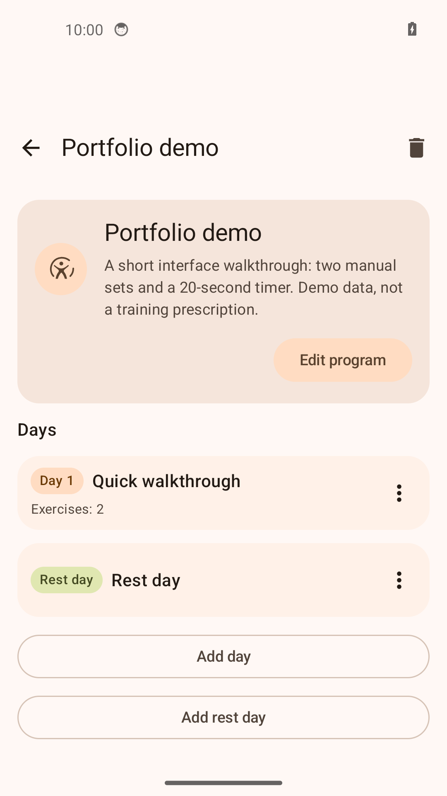
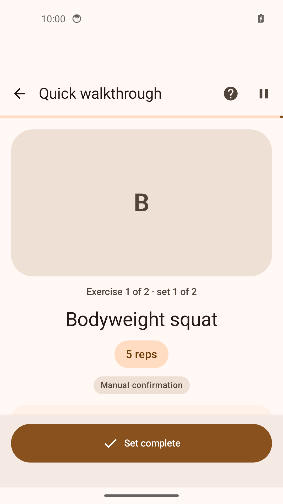
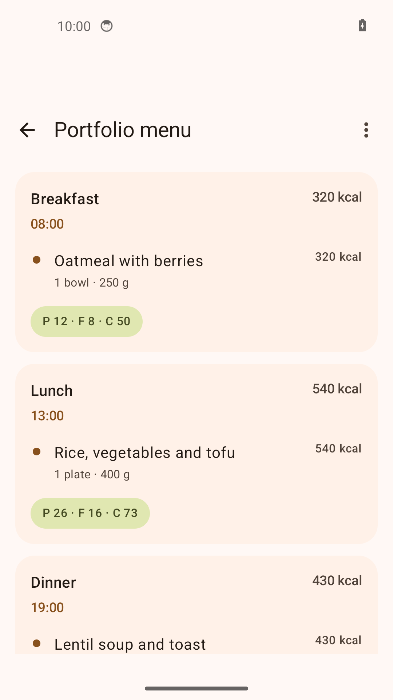
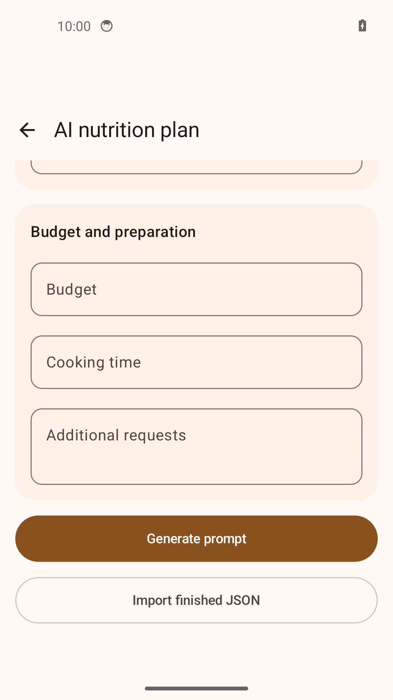

# FitRegimen

[English](README.md) · [Русский](README.ru.md) · [Deutsch](README.de.md) · [Español](README.es.md)

[](https://github.com/IgorNadein/FitRegimen/actions/workflows/android.yml)
[](https://github.com/IgorNadein/FitRegimen/releases)

**An Android app for building training programs, completing guided workouts, and planning meals.** FitRegimen adds these workflows to [FitoTrack](https://codeberg.org/jannis/FitoTrack), the open-source activity tracker created by **Jannis Scheibe and contributors**. Fork development: [Igor Nadein](https://github.com/IgorNadein).

**[Download APK](https://github.com/IgorNadein/FitRegimen/releases/latest) · [Installation](doc/INSTALL.md) · [5-minute demo](doc/demo/README.md) · [Changelog](CHANGELOG.md)**

## What this fork adds

- **Program builder:** ordered days, rest days, an exercise catalog, sets, reps, weights, durations, preparation and rest intervals; JSON import/export.
- **Guided workouts:** manual set confirmation, timers, integration with the existing recorder, persisted session state, and results stored separately from the editable plan.
- **Nutrition planning:** days, meals and foods, quantities, calories and macronutrients; manual editing, JSON exchange, and links to profiles and training programs.
- **AI prompt preparation and validated import of generated plans:** prepare a structured request, use an external assistant of your choice, then import its JSON response. No built-in model, API key, or automatic AI-service connection is required.
- **Portable backups:** training and nutrition plans, exercise catalog and media, profiles, workout/session history, and portable settings; replace or merge on restore.

The engineering work includes Kotlin/Jetpack Compose screens, Room data models and migrations, persisted workout execution, versioned exchange formats, import validation, and regression tests. See the [session architecture](doc/guided-workout-architecture.md) and [test sources](app/src/test/java/de/tadris/fitness).

## Current screens

Screenshots from the Android app using the [bundled demo files](doc/demo). The first screen is the program builder.

| Program builder | Workout in progress |
| --- | --- |
|  |  |
| Nutrition | AI plan import |
|  |  |

## Try it

1. Install the signed **FitRegimen-0.1.0.apk** from [Releases](https://github.com/IgorNadein/FitRegimen/releases/latest) on Android **8.0+**.
2. Download [program.json](https://raw.githubusercontent.com/IgorNadein/FitRegimen/master/doc/demo/program.json). In **Programs → + → Import program**, select it.
3. Open **Quick walkthrough**, complete two manual sets and a 20-second timer, then inspect the result.
4. Export a backup and restore it. Follow the [demo guide](doc/demo/README.md) for the exact steps and expected outcomes, including nutrition and AI import.

No account, GPS recording, or external AI is needed for this demo. The sample files are fictional interface demonstrations, not personalized training or dietary prescriptions.

## What “AI” means here

The app builds a prompt from your inputs and the plan format. Profile inclusion is under your control; if you send the prompt to an external service, that service receives the included data. You save the generated response as JSON and select it in the app.

Program imports check JSON, supported format versions, required structure and exercise references, with compatibility handling for older formats. Nutrition imports additionally limit file size, tree size, text lengths and numeric ranges, and reject private backup fields. Errors are shown to the user; imported plans remain editable. These are **data checks**, not a guarantee that a generated training or meal plan is appropriate for a person. See [AI workflow and limits](doc/AI.md).

Core planning, manual/timed workouts and local import/export work offline. External AI, online maps, remote exercise videos and configured uploads require a connection. See [Privacy](doc/privacy-policy.md).

## Build and checks

Use **JDK 21**, Android SDK **37.0**, Build Tools **36.0.0**, and the included Gradle wrapper:

```sh
sdkmanager 'platforms;android-37.0' 'build-tools;36.0.0'
./gradlew testDebugUnitTest assembleDebug assembleRelease
```

The installable debug APK is at `app/build/outputs/apk/debug/app-debug.apk`; the release output is unsigned until signed by the maintainer. [GitHub Actions](.github/workflows/android.yml) runs JVM tests and both APK builds on pushes and pull requests, and publishes APK artifacts and test reports. It does not run device tests. [Build and release details](doc/INSTALL.md#building-from-source).

## Upstream and license

**GPS/indoor activity recording, route maps, sensor integrations, GPX exchange and the original statistics engine come from FitoTrack.** These are upstream contributions, not claimed as new work by this fork. The new program/session and nutrition workflows extend that foundation.

FitRegimen remains **GPLv3 or later**. Original copyright notices are retained. See [LICENSE.txt](LICENSE.txt), [NOTICE.md](NOTICE.md), [upstream source](https://codeberg.org/jannis/FitoTrack) and [support upstream](https://liberapay.com/jannis/donate). Report FitRegimen issues and contributions in [this repository](https://github.com/IgorNadein/FitRegimen/issues).
