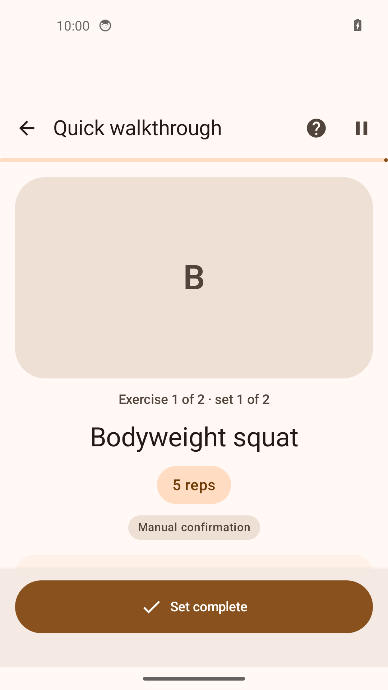
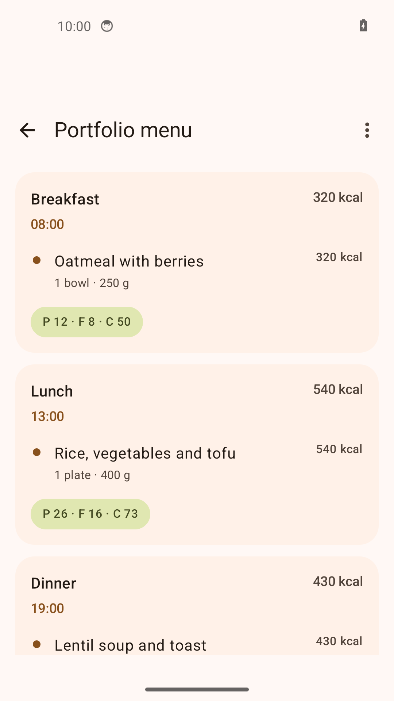
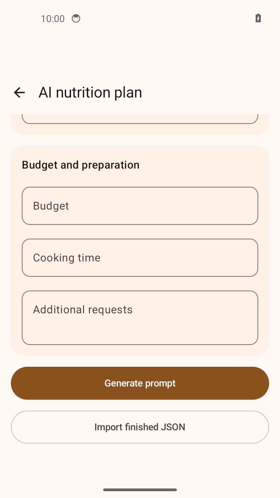

# FitRegimen

[English](README.md) · [Русский](README.ru.md) · [Deutsch](README.de.md) · [Español](README.es.md)

[](https://github.com/IgorNadein/FitRegimen/actions/workflows/android.yml)
[](https://github.com/IgorNadein/FitRegimen/releases)

**Android-приложение для составления программ, выполнения тренировок и планирования питания.** FitRegimen развивает [FitoTrack](https://codeberg.org/jannis/FitoTrack) — открытый трекер активности, созданный **Яннисом Шайбе (Jannis Scheibe) и участниками проекта**. Разработчик форка — [Игорь Надеин](https://github.com/IgorNadein).

**[Скачать APK](https://github.com/IgorNadein/FitRegimen/releases/latest) · [Установка](doc/INSTALL.md) · [Демо за 5 минут](doc/demo/README.ru.md) · [Изменения](CHANGELOG.md)**

## Что добавлено в форке

- **Конструктор программ:** последовательность тренировочных дней и дней отдыха, каталог упражнений, подходы, повторения, вес, длительность, подготовка и отдых; импорт и экспорт JSON.
- **Выполнение тренировки:** подтверждение подходов вручную, таймеры, интеграция с существующим трекером, сохранение состояния сессии и результатов отдельно от редактируемой программы.
- **Планирование питания:** дни, приёмы пищи, продукты, количество, калории и БЖУ; ручной редактор, обмен JSON, связь с профилями и программами тренировок.
- **Подготовка запросов и проверяемый импорт сгенерированных планов:** приложение формирует запрос для выбранного внешнего AI-сервиса, а затем импортирует его JSON-ответ. Встроенная модель, API-ключ и автоматическое подключение к AI-сервису не требуются.
- **Переносимые резервные копии:** программы тренировок и питания, упражнения и медиа, профили, история тренировок и сессий, переносимые настройки; восстановление с заменой или объединением данных.

Инженерный вклад: экраны на Kotlin/Jetpack Compose, модели и миграции Room, сохраняемое выполнение тренировки, версионируемые форматы обмена, проверка импорта и регрессионные тесты. Подробнее: [архитектура сессий](doc/guided-workout-architecture.md) и [исходники тестов](app/src/test/java/de/tadris/fitness).

## Актуальные экраны

Скриншоты работающего приложения с [демонстрационными файлами](doc/demo). Первый экран — конструктор программы.

| Конструктор программы | Выполнение тренировки |
| --- | --- |
|  |  |
| Питание | Импорт AI-плана |
|  |  |

## Попробовать

1. Установите подписанный **FitRegimen-0.1.0.apk** из [релизов](https://github.com/IgorNadein/FitRegimen/releases/latest) на Android **8.0+**.
2. Скачайте [program.json](https://raw.githubusercontent.com/IgorNadein/FitRegimen/master/doc/demo/program.json). Откройте **Программы → + → Импорт программы** и выберите файл.
3. Откройте **Quick walkthrough**, подтвердите два подхода, дождитесь окончания 20-секундного таймера и посмотрите результат.
4. Экспортируйте резервную копию и восстановите её. [Пошаговое демо](doc/demo/README.ru.md) содержит ожидаемые результаты, а также сценарии питания и AI-импорта.

Для демо не нужны аккаунт, запись GPS или внешний AI. Примеры содержат вымышленные данные для знакомства с интерфейсом, а не персональные рекомендации по тренировкам и питанию.

## Как устроена AI-функция

Приложение собирает запрос из ваших параметров и описания формата плана. Включением данных профиля управляете вы; при отправке запроса внешнему сервису он получает включённые данные. Полученный ответ нужно сохранить как JSON и выбрать в приложении.

Импорт программ проверяет JSON, поддерживаемую версию формата, обязательную структуру и ссылки на упражнения, сохраняя совместимость со старыми форматами. Импорт питания дополнительно ограничивает размер файла и структуры, длину текста, диапазоны чисел и отклоняет закрытые поля резервной копии. Ошибки отображаются пользователю; импортированный план можно редактировать. Это **проверки данных**, а не гарантия пригодности плана для конкретного человека. [Подробности и ограничения](doc/AI.md).

Основные функции планирования, ручные тренировки, таймеры и локальный обмен файлами работают офлайн. Внешний AI, онлайн-карты, удалённые видео и настроенные загрузки требуют сети. [Конфиденциальность](doc/privacy-policy.md).

## Сборка и проверки

Нужны **JDK 21**, Android SDK **37.0**, Build Tools **36.0.0** и Gradle wrapper из репозитория:

```sh
sdkmanager 'platforms;android-37.0' 'build-tools;36.0.0'
./gradlew testDebugUnitTest assembleDebug assembleRelease
```

Устанавливаемый debug APK: `app/build/outputs/apk/debug/app-debug.apk`. Release APK требует подписи разработчика. [GitHub Actions](.github/workflows/android.yml) запускает JVM-тесты и обе сборки при push и pull request, сохраняет APK и отчёты. Тесты на устройстве в CI не запускаются. [Подробнее о сборке и установке](doc/INSTALL.md).

## Исходный проект и лицензия

**Запись GPS и занятий в помещении, карты маршрутов, интеграции с датчиками, обмен GPX и исходный движок статистики созданы в FitoTrack.** Форк сохраняет авторство этой работы и расширяет её программами, сессиями и питанием.

Лицензия — **GPLv3 или более поздняя версия**. Исходные уведомления об авторских правах сохранены: [LICENSE.txt](LICENSE.txt), [NOTICE.md](NOTICE.md), [исходники FitoTrack](https://codeberg.org/jannis/FitoTrack), [поддержка автора FitoTrack](https://liberapay.com/jannis/donate). Ошибки и предложения по FitRegimen — в [этом репозитории](https://github.com/IgorNadein/FitRegimen/issues).
