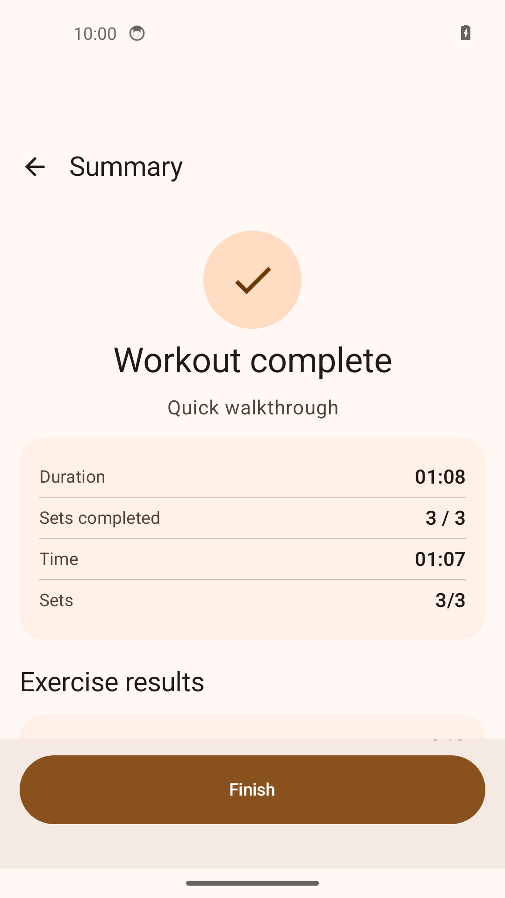

# Демонстрация за пять минут

[English](README.md) · [Русский](README.ru.md)

Установите [подписанный APK](https://github.com/IgorNadein/FitRegimen/releases/latest)
по [инструкции](../INSTALL.md). Скачайте в «Загрузки» на телефоне файлы, также
прикреплённые к релизу:

- [program.json](https://raw.githubusercontent.com/IgorNadein/FitRegimen/master/doc/demo/program.json): два ручных подхода, таймер на 20 секунд и день отдыха.
- [nutrition.json](https://raw.githubusercontent.com/IgorNadein/FitRegimen/master/doc/demo/nutrition.json): вымышленный день питания с тремя приёмами пищи.
- [portfolio-backup.ftb](https://github.com/IgorNadein/FitRegimen/releases/download/v0.1.0/portfolio-backup.ftb): резервная копия завершённого демо, созданная приложением.

Это примеры для проверки интерфейса, а не персональные рекомендации. Аккаунт,
внешний AI и GPS не нужны. Ниже приведены английские названия кнопок, соответствующие
скриншотам; при другом языке приложения те же элементы переведены.

## 1. Импортировать и изучить программу

Откройте **Programs → + → Import program** и выберите `program.json` в системном
диалоге Android. Если список **Recent** пуст, откройте боковое меню → **Downloads**.

**Ожидаемый результат:** открылась **Portfolio demo**. В меню **⋮ → Edit program**
есть **Quick walkthrough** и **Rest day**. Откройте **Quick walkthrough**, затем
**Bodyweight squat**, чтобы увидеть повторения, подходы и режим выполнения.
Вернитесь назад без изменений, чтобы сохранить сценарий примера.

## 2. Пройти тренировку и увидеть результат

На экране программы нажмите **Start program** — первый день назначится на сегодня.
Нажмите **Start workout**, чтобы открыть обзор, затем ещё раз **Start workout**.

1. После трёх секунд подготовки нажмите **Set complete** для первого подхода на 5 повторений.
2. Дождитесь короткого отдыха и подготовки, подтвердите второй подход через **Set complete**.
3. Дождитесь перехода и завершения 20-секундного таймера **Standing recovery**.
   Последний подход завершится автоматически.

Для демонстрации интерфейса можно подтверждать подходы, не выполняя упражнения
физически. Видео, GPS и подключение датчиков не используются.

**Ожидаемый результат:** экран **Workout complete**, выполнено **3 / 3** подхода
в двух упражнениях. Нажмите **Finish**, вернитесь в **Workouts** и откройте сохранённый
результат. Последующее редактирование программы не переписывает снимок завершённой сессии.

## 3. Питание и импорт AI-плана

Откройте **Food → + → Import plan**, выберите `nutrition.json`.

**Ожидаемый результат:** **Portfolio menu → Demo day** с **Breakfast**, **Lunch**,
**Dinner**. Сумма примерных значений продуктов: **1290 ккал**, 60 г белков,
34 г жиров, 186 г углеводов. Это вымышленные значения для интерфейса, а не суточная норма.
Откройте редактор дня или приёма пищи и изучите структуру.

Для AI-сценария откройте **Food → + → AI nutrition plan**. Здесь доступны цель,
профили, контекст тренировок, подготовка запроса и **Import finished JSON** внизу
экрана. Через эту кнопку можно импортировать тот же `nutrition.json` вместо обычного
импорта выше. Достаточно одного импорта, иначе появится ещё одна копия плана.
Внешний AI для проверки не нужен: пример написан вручную в том же формате обмена.

Запрос для тренировочной программы находится в **Programs → + → AI prompt**;
его JSON-ответ импортируется через **Import program**.
[Что именно проверяет импорт](../AI.md).

## 4. Восстановить резервную копию

Проверяйте **Replace** на отдельной демонстрационной установке: этот режим заменяет
локальные данные приложения. Если используете основную установку, сначала сохраните
свою копию либо выберите объединение **Merge**.

1. Откройте **Settings → Database → Export Data → Backup**.
2. Файл `.ftb` — ZIP-архив. Сохраните его через файловый менеджер в системном меню «Поделиться» или отправьте
   его в выбранное хранилище, из которого сможете скачать обратно на телефон.
3. Нажмите **Import Data Backup → Replace → Restore**, выберите сохранённый ZIP
   или `portfolio-backup.ftb` из релиза. Для объединения вместо замены есть **Merge**.
4. Вернитесь в **Programs**, **Food** и **Workouts**.

**Ожидаемый результат:** программа, питание и результат завершённой тренировки
доступны после восстановления. В готовой копии тренировка датирована **9 сентября
2026 года**: если в сегодняшнем дне программы её не видно, откройте **Workouts**
или выберите эту дату. JSON программы переносит её определение, а полная резервная
копия — ещё и историю сессий. Импорт JSON и восстановление ZIP — разные операции.

Чтобы наглядно проверить замену на отдельной установке, после экспорта переименуйте
**Portfolio demo** в **Temporary edit**, затем восстановите копию через **Replace**.
Исходное название и завершённая тренировка должны вернуться.

## Проверка релиза

Сценарий проверен на чистом эмуляторе Android 14 / API 34 x86_64 с подписанным APK:
импорт → конструктор → ручные подходы и таймер → результат → питание → экспорт
полной копии → очистка данных демо-установки → восстановление с заменой → повторная проверка планов и истории.
[Сведения о скриншотах](../screenshots/portfolio/README.md).
Примеры JSON также проверяются штатными импортёрами в
[PortfolioDemoTest](../../app/src/test/java/de/tadris/fitness/data/backup/PortfolioDemoTest.kt).
